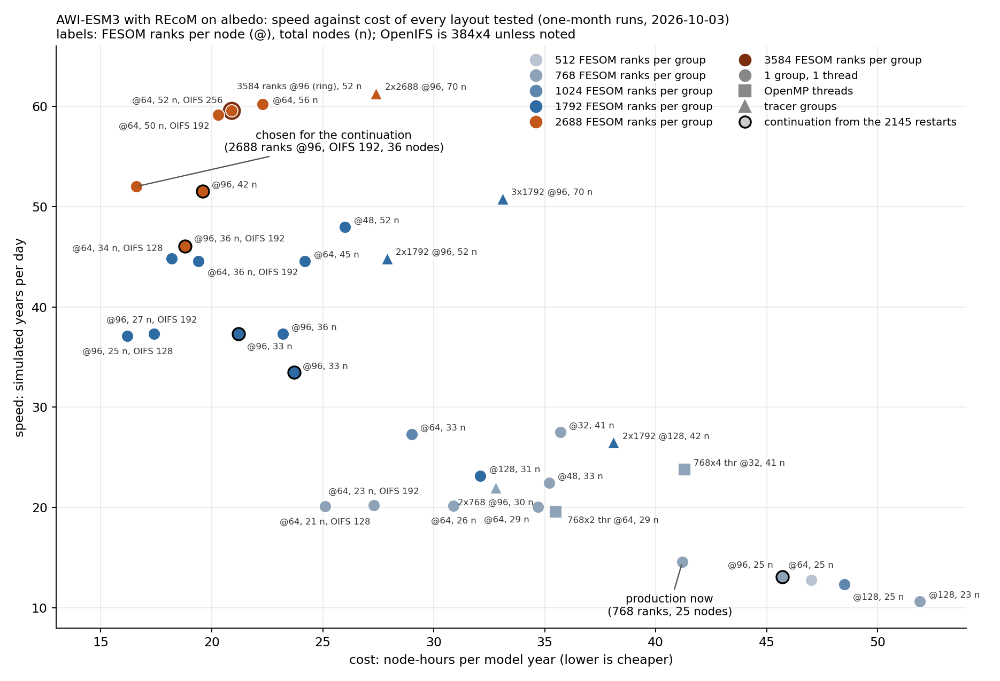

# AWI-ESM3 on albedo — run-speed investigation

Why the AWI-ESM3 CMIP7 spin-up (TCO95L91 OpenIFS, CORE3 FESOM2 with cavities,
LPJ-GUESS, XIOS, OASIS3-MCT) ran slower on AWI's albedo than on DKRZ's levante
after the move on 2026-09-26, how its layout was changed until it ran faster
on fewer nodes, and how to lay it out once the carbon cycle (REcoM) makes FESOM
almost seven times as expensive.

## Headline numbers without REcoM (physics only)

Seconds of wall-clock per model day in steady state (model days 2 to 58 of a
2-month leg, from `ifs.stat`), all at the 1800 s FESOM step:

| layout | nodes | s per model day |
|---|---|---|
| levante, FESOM 1792 x 1 (reference) | 47 | 2.77 |
| albedo, FESOM 1792 x 1 | 47 | 3.04 |
| + FESOM main with the OpenMP performance stack | 47 | 2.72 |
| FESOM 768 x 2 threads, XIOS and rnfmap on the OpenIFS nodes | 29 | 2.65 |
| FESOM 768 x 1 on 2 reserved cores per rank, 2 XIOS per OpenIFS node | 29 | 2.39 |
| FESOM 768 x 1 at 96 ranks per node | **25** | **2.40** |

2.40 s per model day is about 99 simulated years per day in steady state, on
roughly half the nodes of the starting layout.

What made the difference:

- **FESOM time step 1200 s -> 1800 s.** At 1200 s FESOM limited the coupled
  model on albedo; at 1800 s FESOM and OpenIFS are balanced (LUCIA timelines).
- **No MPI setting explained the albedo/levante gap.** Transport and collective
  settings that make MPI benchmarks 2 to 7 times faster left the model unchanged;
  FESOM at 1792 ranks polls MPI two thirds to three quarters of its time on both
  machines.
- **Spread FESOM ranks out, and run them single-threaded.** Hardware counters
  show the busy cores of an AMD EPYC 7702 node boost higher when their
  neighbours are idle: FESOM runs at 2.84 GHz at 64 ranks per node, 2.55 GHz at
  96 and 2.33 GHz packed 128 per node. DRAM traffic stays far below the node's
  bandwidth. A second OpenMP thread per rank costs more than it gains.
- **Components share nodes.** XIOS and the runoff mapper run on the OpenIFS
  nodes (esm_tools `interleave_into`, `ranks_per_node`; esm-tools/esm_tools#1603).
- OpenIFS and FESOM now share the critical path: OpenIFS's radiation and output
  steps are the longest intervals, FESOM is longer in over half of the rest. More
  OpenIFS ranks (768 x 2 instead of 384 x 4) made OpenIFS slower.

At the 1200 s FESOM step, FESOM 1024 x 1 at 64 ranks per node on 33 nodes runs a
10-year leg in 2 h 46 min (2.72 s per model day including start-up and restarts).

## Headline numbers with REcoM (develop-cc, 33 FESOM tracers)

One-month tests, 1800 s FESOM step, steady state (model days 2 to 30):

| layout | nodes | s per model day | SYPD | node-hours per model year |
|---|---|---|---|---|
| physics layout above: FESOM 768 x 1 at 96 per node, OpenIFS 384 x 4 | 25 | 16.24 | 14.6 | 41.2 |
| FESOM 1792 x 1 at 96 per node, LPJ-GUESS 64 x 2 | 33 | 6.34 | 37.3 | 21.2 |
| FESOM 2688 x 1 at 96 per node, LPJ-GUESS 64 x 2 | 42 | 4.59 | 51.5 | 19.6 |
| **same with OpenIFS 192 x 4** | **36** | **4.55** | **52.0** | **16.6** |
| FESOM 3584 x 1 at 96 per node | 52 | 3.97 | 59.6 | 20.9 |

- **FESOM's rank count is the lever.** The tracer step (two thirds of FESOM's time)
  keeps scaling to 2688 ranks; more ranks are faster and cheaper at the same time.
  96 ranks per node is the cheapest density, 128 per node the slowest.
- **OpenMP threads and tracer groups lose to plain ranks** on the same nodes.
  Groups only run with FESOM's XIOS output after an OASIS fix (the report has the
  cause); even then 2 x 1792 ranks are 33 % slower than 1 x 3584 on 52 nodes.
- **OpenIFS and LPJ-GUESS can shrink** (192 x 4 and 64 x 2 keep up), but OpenIFS's
  restart is tied to its rank and thread count, so shrinking it means starting the
  atmosphere from initial conditions.
- Identical one-month jobs differ by up to 11 % depending on the nodes.

## Files

- `albedo_performance.tex` / `.pdf` — the living report: the campaign in the
  order it happened, the current state, falsified claims (struck through, with
  the observation that killed them), method notes. Updated 2026-10-16: physics
  layouts up to the 1200 s test, then the REcoM layouts.
- `fig_albedo_vs_levante.png` — per-day speed of the same configuration on both machines.
- `fig_fesom_spread.png`, `fig_critical_path.png` — FESOM compute and clock against ranks per node;
  OpenIFS and FESOM compute per coupling interval in the 25-node layout (`bench/make_figs_20260929.py`).
- `bench/mpibench.c`, `bench/*.slurm`, `bench/*.out` — MPI point-to-point and
  collective benchmarks, albedo against levante, with their outputs.
- `bench/pcsampler.c`, `bench/pcs_report.py`, `bench/prof_*.txt` — an
  LD_PRELOAD SIGPROF program-counter sampler (no perf or ptrace needed), its
  report script, and FESOM profiles from both machines.
- `bench/lucia_timeline.py` — compute and wait time per component from the
  OASIS LUCIA timelines (the LUCIA summary's OpenIFS column is wrong).
- `bench/lucia_steps.py` — the same per coupling interval: which component is
  on the critical path at which step.
- `bench/pmcwin.c`, `bench/pmc_summary.py` — hardware counters (clock, IPC,
  DRAM fills) on running model processes through `perf_event_open`, usable at
  `perf_event_paranoid=2` without perf or likwid.
- `bench/ifsstat_days.awk` — seconds per model day from an OpenIFS `ifs.stat`.
- `cc_perf/` — the REcoM tests: `make_cc_test.py` (one-month test runscripts),
  `cc_eval.sh` (speed and FESOM timers per test), `results_20261003.txt` (all
  tests), `plot_sypd_cost.py` (`fig_recom_sypd_cost.png`), `reorder_cc.sh` and
  `check_order.py` (OASIS coupling files reordered and checked for a new FESOM
  partition).
